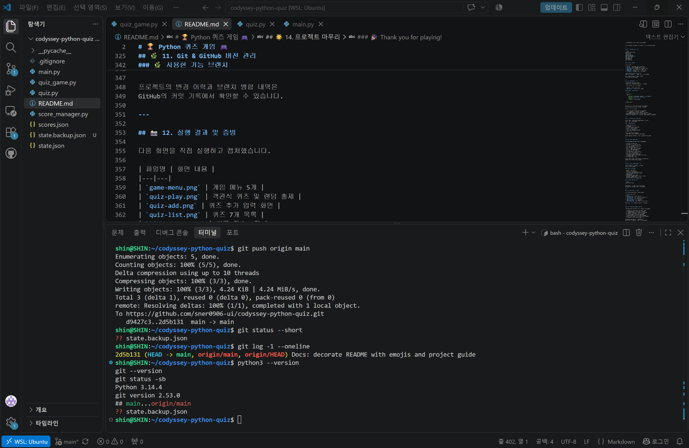
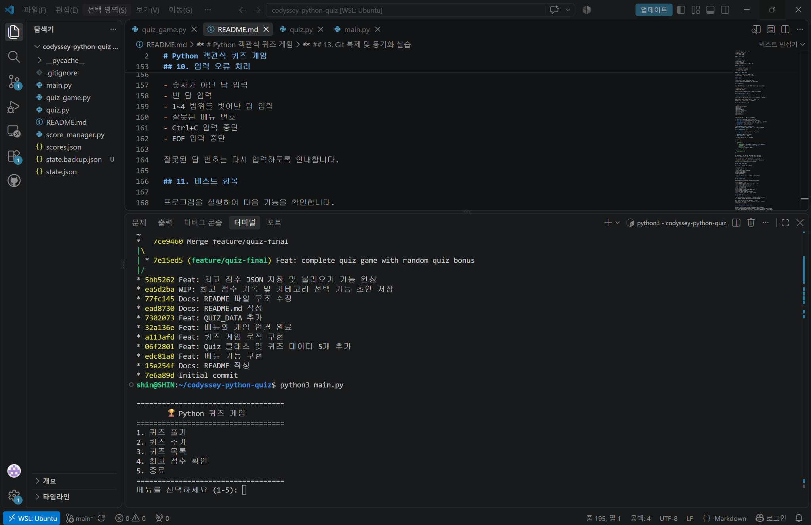
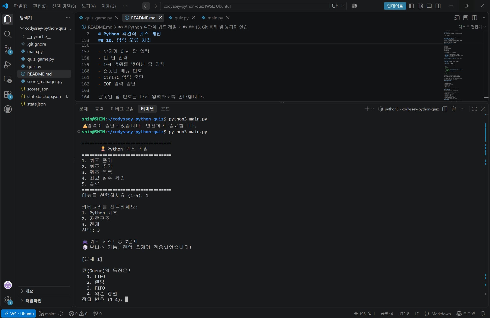
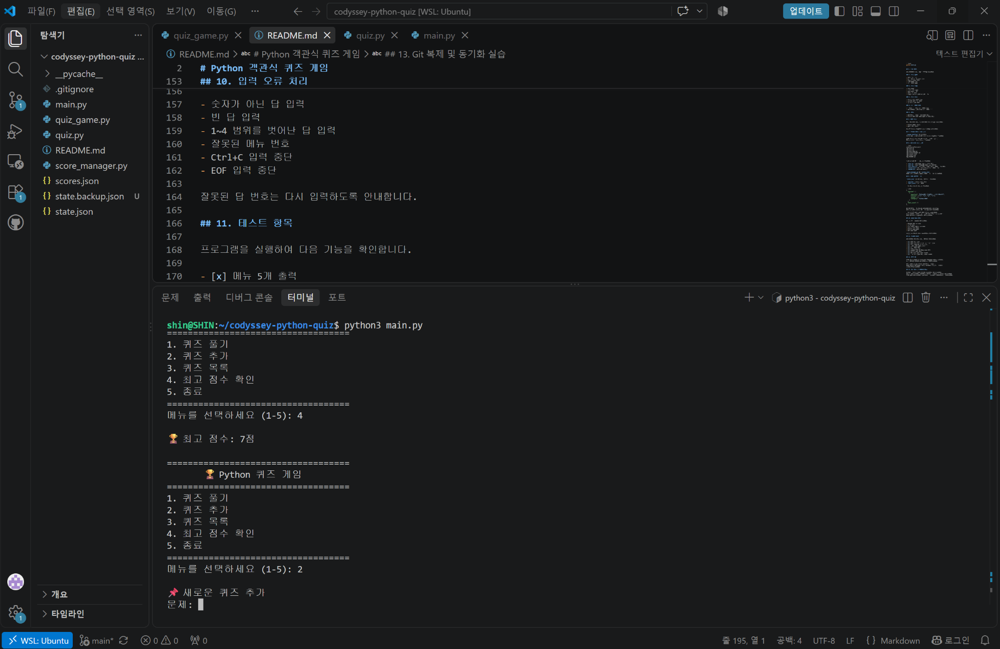
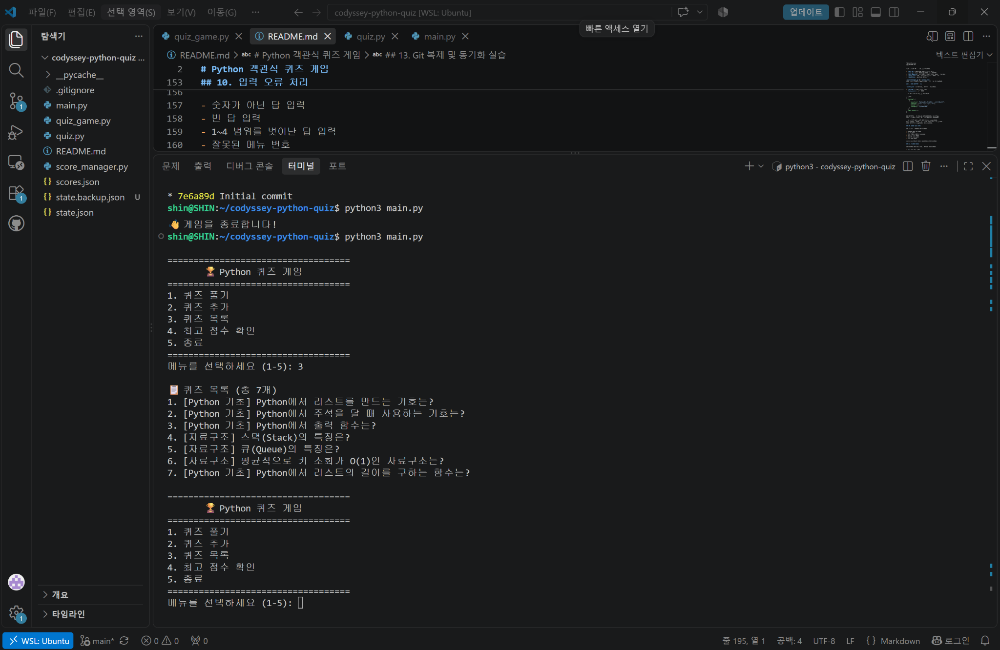
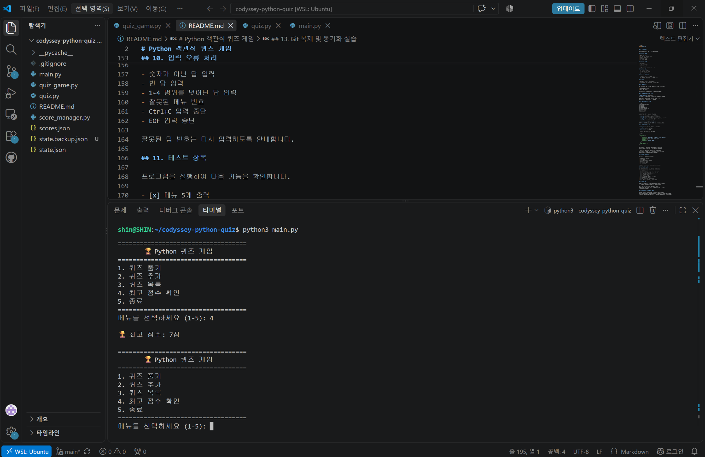
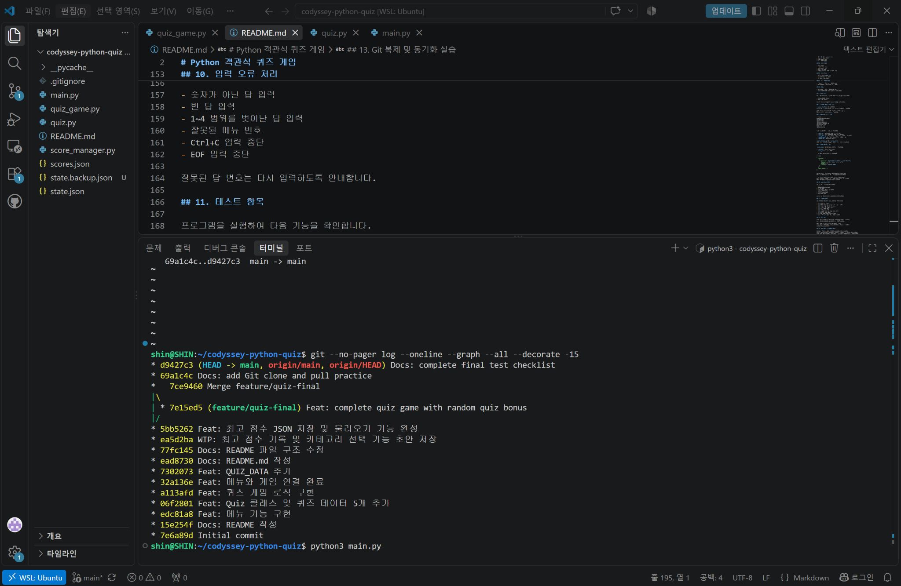

# 🏆 Python 퀴즈 게임 🎮

### 🐣 Python을 배우며 직접 만든 4지선다 퀴즈 게임!

Python 기초와 자료구조를 재미있게 복습할 수 있는
**터미널 기반 객관식 퀴즈 게임**입니다.

문제를 풀고, 나만의 퀴즈를 추가하고, 최고 점수에 도전해 보세요! ✨

---

## 📌 1. 프로젝트 소개

Python을 처음 배우면서 클래스, 함수, 반복문,
조건문과 파일 저장 기능을 직접 활용해 보기 위해
제작한 퀴즈 게임입니다.

게임에는 다음과 같은 기능이 있습니다.

- 🎯 4지선다 퀴즈 풀기
- ✏️ 새로운 퀴즈 추가하기
- 📚 전체 퀴즈 목록 확인하기
- 🏆 최고 점수 저장 및 확인하기
- 💾 JSON 파일로 데이터 저장하기
- 🎲 랜덤 출제 기능 (보너스 과제)

---

## 💡 2. 주제 선정 이유

Python 기초 문법과 자료구조는 프로그래밍을 공부할 때
반복해서 접하게 되는 중요한 내용입니다.

단순히 설명을 읽는 것보다 퀴즈로 직접 풀어보면
공부한 내용을 더 재미있게 복습할 수 있다고 생각했습니다.

또한 학습하면서 새롭게 알게 된 내용을
직접 문제로 추가할 수 있도록 만들었습니다.

---

## 🛠️ 3. 개발 환경 및 사용 기술

| 항목 | 내용 |
|---|---|
| 🐍 프로그래밍 언어 | Python 3.10 이상 |
| 💻 개발 도구 | Visual Studio Code |
| 🐧 개발 환경 | WSL: Ubuntu |
| 📦 외부 라이브러리 | 사용하지 않음 |
| 💾 데이터 저장 | JSON |
| 🌿 버전 관리 | Git & GitHub |
| 🎲 랜덤 기능 | Python `random` 모듈 |

사용한 Python 표준 라이브러리:

- `json` : 퀴즈와 최고 점수 저장
- `pathlib` : 저장 파일 경로 관리
- `random` : 퀴즈 출제 순서 섞기

---

## 🚀 4. 실행 방법

### 📂 프로젝트 준비

GitHub 저장소를 복제합니다.

```bash
git clone https://github.com/sner0906-ui/codyssey-python-quiz.git
```

프로젝트 폴더로 이동합니다.

```bash
cd codyssey-python-quiz
```

### ▶️ 게임 실행

Ubuntu 또는 macOS 터미널:

```bash
python3 main.py
```

Windows에서 Python이 `python` 명령어로 등록되어 있다면:

```bash
python main.py
```

별도의 외부 라이브러리 설치는 필요하지 않습니다.

---

## 🎮 5. 게임 메뉴

프로그램을 실행하면 아래와 같은 메뉴가 표시됩니다.

```text
===================================
       🏆 Python 퀴즈 게임
===================================
1. 퀴즈 풀기
2. 퀴즈 추가
3. 퀴즈 목록
4. 최고 점수 확인
5. 종료
===================================
메뉴를 선택하세요 (1-5):
```

### 🎯 1번 — 퀴즈 풀기

원하는 카테고리를 선택하여 퀴즈를 풀 수 있습니다.

- Python 기초
- 자료구조
- 전체

각 문제에는 선택지 4개가 제공되며,
정답 번호 1~4 중 하나를 입력합니다.

```text
Python에서 리스트를 만드는 기호는?

1. ()
2. []
3. {}
4. <>

정답 번호 (1-4): 2
✅ 정답입니다!
```

문제를 모두 풀면 최종 점수가 출력됩니다.

### ✏️ 2번 — 퀴즈 추가

사용자가 직접 새로운 문제를 등록할 수 있습니다.

입력하는 정보:

1. 문제 내용
2. 선택지 4개
3. 정답 번호 (1~4)
4. 카테고리

추가한 문제는 `state.json` 파일에 저장되어
프로그램을 다시 실행해도 유지됩니다.

### 📚 3번 — 퀴즈 목록

등록된 모든 퀴즈의 카테고리와 문제를 확인합니다.

처음에는 기본 퀴즈 6개가 제공됩니다.

개발 및 테스트 과정에서는 새로운 퀴즈 1개를 추가하여
총 7개의 퀴즈가 표시되는 것을 확인했습니다.

### 🏆 4번 — 최고 점수 확인

퀴즈를 풀어 얻은 최고 점수를 확인할 수 있습니다.

이전 최고 점수를 넘으면 새로운 기록이 저장됩니다.

개발 과정에서 최고 점수가 5점에서 7점으로
갱신되는 것도 확인했습니다.

### 👋 5번 — 종료

현재 퀴즈 데이터와 최고 점수를 저장하고
프로그램을 종료합니다.

---

## 🎲 6. 보너스 과제 — 랜덤 출제

### ✨ 구현한 보너스 기능

**퀴즈를 시작할 때마다 문제 순서를 무작위로 섞습니다!**

Python 표준 라이브러리의 `random.shuffle()`을 사용했습니다.

```python
import random

random.shuffle(quizzes)
```

랜덤 출제는 등록된 퀴즈를 삭제하지 않고
이번 게임에서 사용할 문제의 순서만 변경합니다.

게임 실행 시 다음 안내가 표시됩니다.

```text
🎮 퀴즈 시작! 총 7문제
🎲 보너스 기능: 랜덤 출제가 적용되었습니다!
```

✅ 실제 실행에서 첫 번째 출제 문제가 달라지는 것을 확인했습니다.

---

## 📁 7. 프로젝트 파일 구조

```text
codyssey-python-quiz/
├── main.py
├── quiz.py
├── quiz_game.py
├── score_manager.py
├── scores.json
├── state.json
├── README.md
└── .gitignore
```

### 🧩 각 파일의 역할

| 파일 | 역할 |
|---|---|
| `main.py` | 프로그램 시작 및 메뉴 실행 |
| `quiz.py` | Quiz 클래스와 기본 퀴즈 6개 |
| `quiz_game.py` | 게임 진행 및 주요 기능 구현 |
| `state.json` | 퀴즈 목록과 최고 점수 저장 |
| `README.md` | 프로젝트 소개 및 사용 안내 |
| `.gitignore` | Git에서 제외할 파일 설정 |

`score_manager.py`와 `scores.json`은
초기 개발 과정에서 만든 점수 관리 관련 파일입니다.

현재 게임의 퀴즈와 최고 점수 저장에는
`state.json`을 사용합니다.

---

## 💾 8. JSON 데이터 저장

게임 데이터는 프로젝트 폴더의
`state.json` 파일에 UTF-8 형식으로 저장합니다.

저장되는 정보는 다음과 같습니다.

- `quizzes` : 등록된 퀴즈 목록
- `best_score` : 지금까지의 최고 점수

### 📋 JSON 저장 형식 예시

```json
{
  "quizzes": [
    {
      "question": "Python에서 리스트를 만드는 기호는?",
      "choices": ["()", "[]", "{}", "<>"],
      "answer": 2,
      "category": "Python 기초"
    }
  ],
  "best_score": 7
}
```

위 코드는 저장 구조를 보여주기 위한 예시입니다.
실제 파일에는 등록된 전체 퀴즈가 저장됩니다.

### 🔄 저장 및 불러오기

- 저장 파일이 없으면 기본 퀴즈로 시작합니다.
- 퀴즈를 추가하면 변경사항을 저장합니다.
- 최고 점수가 갱신되면 새로운 점수를 저장합니다.
- 프로그램을 다시 실행해도 저장된 데이터가 유지됩니다.
- JSON 파일이 손상되면 경고를 표시하고 기본 데이터로 시작합니다.

---

## 🛡️ 9. 입력 오류 및 예외 처리

잘못된 입력 때문에 게임이 갑자기 중단되지 않도록
입력 검사를 구현했습니다.

### ⚠️ 처리하는 상황

- 숫자가 아닌 값 입력
- 빈 값 입력
- 1~4 범위를 벗어난 정답 번호
- 존재하지 않는 메뉴 번호
- `Ctrl + C` 입력 중단
- `Ctrl + D` 등의 EOF 입력 중단
- 손상된 JSON 저장 파일

잘못된 정답 번호를 입력하면
올바른 번호를 다시 입력하도록 안내합니다.

입력이 중단되면 데이터를 저장하고 안전하게 종료합니다.

---

## 🧪 10. 기능 테스트 결과

실제 프로그램을 실행하여 확인한 항목입니다.

- [x] 메뉴 5개 정상 출력
- [x] 기본 객관식 퀴즈 6개 출력
- [x] 선택지 4개와 정답 번호 출력
- [x] 퀴즈 추가 후 총 7개 표시
- [x] 재실행 후 추가한 퀴즈 유지
- [x] 최고 점수 저장 및 불러오기
- [x] 최고 점수 7점 갱신 확인
- [x] 랜덤 출제 기능 확인
- [x] 문자 입력 시 재입력 안내
- [x] 범위를 벗어난 숫자 입력 처리
- [x] `Ctrl + C` 안전 종료
- [x] EOF 입력 중단 시 안전 종료
- [x] 손상된 JSON 파일에서 기본 퀴즈로 시작
- [x] Python 문법 검사
- [x] GitHub Push 및 Pull

손상된 JSON 테스트는 원본 데이터를 보호하기 위해
별도의 임시 폴더에서 진행했습니다.

---

## 🌿 11. Git & GitHub 버전 관리

Git을 사용하여 개발 단계별 변경사항을
커밋으로 기록했습니다.

### ✅ 진행한 Git 작업

- GitHub 저장소 연결
- 기능 개발 브랜치 생성
- 브랜치에서 프로그램 완성 코드 커밋
- `main` 브랜치에 기능 브랜치 병합
- GitHub에 Push
- 별도 폴더에 저장소 Clone
- 복제본에서 README 수정 후 Commit 및 Push
- 원본 프로젝트에서 Pull
- Git 커밋 기록과 병합 그래프 확인

### 🌿 사용한 기능 브랜치

```text
feature/quiz-final
```

프로젝트의 변경 이력과 브랜치 병합 내역은
GitHub의 커밋 기록에서 확인할 수 있습니다.

---

## 📸 12. 실행 결과 및 증빙

다음 화면을 직접 실행하고 캡처했습니다.

| 파일명 | 화면 내용 |
|---|---|
| `game-menu.png` | 게임 메뉴 5개 |
| `quiz-play.png` | 객관식 퀴즈 및 랜덤 출제 |
| `quiz-add.png` | 퀴즈 추가 입력 화면 |
| `quiz-list.png` | 퀴즈 7개 목록 |
| `high-score.png` | 최고 점수 7점 |
| `git-history.png` | 커밋 기록 및 브랜치 병합 |

아래는 직접 실행하고 캡처한 화면입니다.

### 💻 개발환경



### 🎮 게임 메뉴



### 🎯 퀴즈 풀이와 랜덤 출제



### ✏️ 퀴즈 추가



### 📚 퀴즈 목록



### 🏆 최고 점수



### 🌿 Git 커밋과 브랜치 병합




---

## 📖 13. 이번 프로젝트에서 배운 점

이번 프로젝트를 진행하면서 다음 작업을 경험했습니다.

- 🐍 Python으로 실행 가능한 프로그램 만들기
- 🧩 클래스와 함수를 활용해 코드 구성하기
- 🔁 반복문과 조건문으로 메뉴와 게임 실행하기
- 💾 JSON 파일로 데이터 저장 및 불러오기
- 🛡️ 잘못된 입력과 예외 상황 처리하기
- 🎲 Python 기본 라이브러리로 기능 추가하기
- 🌿 Git 브랜치, 커밋, 병합, Push, Pull 사용하기
- 🤝 GitHub를 활용한 프로젝트 버전 관리

프로그램을 직접 실행하고 테스트하면서
기능이 어떻게 연결되는지 확인할 수 있었습니다.

앞으로 각 함수와 클래스의 역할을 더 자세히 복습하고,
구현 과정을 직접 설명할 수 있도록 학습할 계획입니다.

---

## 🔍 부록. 설계와 개발 과정 설명

### 🌿 A. Git 커밋 기록과 증빙

현재 저장소에는 **10개 이상의 의미 있는 커밋**이 있습니다.

미션 요구사항인 10개 이상의 커밋을 충족합니다.

- [📜 GitHub 커밋 기록 보기](https://github.com/sner0906-ui/codyssey-python-quiz/commits/main/)
- [📷 Git 커밋과 브랜치 병합 스크린샷](docs/screenshots/git-history.png)

커밋은 메뉴, Quiz 클래스, 퀴즈 데이터, 게임 기능,
점수 저장, README 등 개발 작업을 기록하는 데 사용했습니다.

### 📝 B. 커밋 메시지 작성 원칙

변경 내용을 알아보기 쉽도록 다음 형식을 사용합니다.

`종류: 변경한 내용`

주요 종류는 다음과 같습니다.

- `Feat`: 새로운 기능 추가
- `Fix`: 오류 수정
- `Docs`: README 등 문서 수정
- `Refactor`: 기능은 유지하면서 코드 구조 개선

예를 들어 새로운 기능이 완성되면
`Feat: 퀴즈 출제 기능 구현`처럼 작성할 수 있습니다.

하나의 커밋에는 가능한 한 관련된 변경사항을 묶고,
메시지에는 실제 변경한 내용을 적는 것을 원칙으로 합니다.

### 🧩 C. 클래스를 사용한 이유

이 프로그램은 두 개의 주요 클래스로 역할을 나누었습니다.

**Quiz 클래스 (`quiz.py`)**

하나의 퀴즈가 가지는 문제, 선택지, 정답, 카테고리를
묶어서 관리합니다.

`display()`는 문제와 선택지를 보여주고,
`check_answer()`는 사용자의 정답을 확인합니다.

**QuizGame 클래스 (`quiz_game.py`)**

전체 퀴즈 목록, 최고 점수, 메뉴, 게임 진행,
퀴즈 추가, 데이터 저장과 불러오기를 관리합니다.

함수만 사용해서 구현할 수도 있지만,
클래스를 사용하면 관련 데이터와 기능을 함께 관리할 수 있습니다.

특히 여러 퀴즈가 각각 다른 문제와 정답을 가져도
동일한 Quiz 구조로 다룰 수 있다는 장점이 있습니다.

### 💾 D. JSON을 선택한 이유

JSON은 데이터를 사람이 읽기 쉬운 글자 형태로 저장할 수 있습니다.

또한 목록과 객체처럼 구조화된 데이터를 표현할 수 있어
퀴즈와 최고 점수를 하나의 파일에 보관하기 적합합니다.

Python의 `json` 표준 라이브러리를 사용할 수 있으므로
별도 프로그램이나 외부 라이브러리 설치가 필요하지 않습니다.

`state.json`의 주요 필드는 다음과 같습니다.

- `quizzes`: 문제들을 목록으로 저장
- `question`: 문제 내용
- `choices`: 4개의 선택지
- `answer`: 정답 번호
- `category`: 문제 분류와 카테고리 선택에 사용
- `best_score`: 지금까지의 최고 점수

### 🌱 E. 브랜치 생성과 병합 이유

`feature/quiz-final` 브랜치를 생성하여
최종 퀴즈 게임 기능과 보너스 기능을 별도로 기록했습니다.

브랜치를 사용하면 기본 `main` 브랜치와
기능 개발 작업을 구분할 수 있습니다.

작업 내용을 커밋한 뒤 `main`으로 이동하여
`git merge --no-ff` 명령으로 병합했습니다.

이를 통해 기능 브랜치에서 작업한 기록과
기본 브랜치에 통합한 시점을 확인할 수 있습니다.

앞으로도 새 기능은 `feature/` 브랜치,
오류 수정은 `bugfix/` 브랜치로 구분할 수 있습니다.

### ⚖️ F. JSON 저장 방식의 한계

현재 프로젝트는 작은 퀴즈 게임이므로
JSON 파일 한 개에 데이터를 저장하는 방법이 간단하고 적합합니다.

하지만 퀴즈가 매우 많아지면 다음과 같은 한계가 있습니다.

- 파일을 읽을 때 전체 퀴즈 데이터를 메모리에 올립니다.
- 저장할 때 전체 데이터를 다시 파일에 기록합니다.
- 데이터가 많아질수록 읽기와 저장에 시간이 더 걸릴 수 있습니다.
- 여러 사용자가 동시에 파일을 변경하면 충돌이 발생할 수 있습니다.

퀴즈와 사용자가 많아지는 프로그램으로 확장한다면
SQLite 같은 데이터베이스 사용을 고려할 수 있습니다.

### 🗂️ G. 기능을 수정할 때 확인할 파일

| 변경할 기능 | 파일 | 관련 함수 또는 메서드 |
|---|---|---|
| 메뉴 선택 동작 | `main.py` | `main()` |
| 메뉴 표시 | `quiz_game.py` | `show_menu()` |
| 문제 및 선택지 출력 | `quiz.py` | `display()` |
| 정답 확인 | `quiz.py` | `check_answer()` |
| 기본 퀴즈 수정 | `quiz.py` | `QUIZ_DATA` |
| 숫자 입력 검증 | `quiz_game.py` | `read_number()` |
| 퀴즈 출제 | `quiz_game.py` | `play()` |
| 퀴즈 추가 | `quiz_game.py` | `add_quiz()` |
| 퀴즈 목록 | `quiz_game.py` | `show_list()` |
| 최고 점수 확인 | `quiz_game.py` | `show_high_score()` |
| 데이터 불러오기 | `quiz_game.py` | `load_data()` |
| 데이터 저장 | `quiz_game.py` | `save_data()` |

### 🛡️ H. 데이터 오류 및 복구 방법

저장 파일이 없으면 기본 퀴즈 데이터로 시작합니다.

저장 파일 내용이 손상된 경우 안내 메시지를 출력하고
기본 퀴즈 데이터로 시작하도록 구현했습니다.

`save_data()`는 임시 파일에 데이터를 작성한 다음
기존 저장 파일로 교체하는 방식을 사용합니다.

중요한 데이터를 별도로 보존하려면
파일을 수정하거나 복구 테스트를 하기 전에
`state.json`을 다른 위치에 복사해 두는 것이 좋습니다.

현재 자동으로 이전 버전 전체를 백업하는 기능은
구현하지 않았으며, 백업은 별도로 수행해야 합니다.

---

## 🌟 14. 프로젝트 마무리

처음에는 간단한 Python 퀴즈 프로그램으로 시작했지만,
기능을 하나씩 추가하면서 객관식 퀴즈 게임을 완성했습니다.

특히 **데이터 저장**, **예외 처리**, **랜덤 출제**,
**GitHub 버전 관리**까지 경험할 수 있었습니다.

### 🎉 Thank you for playing!

**Made with Python 🐍💛**
